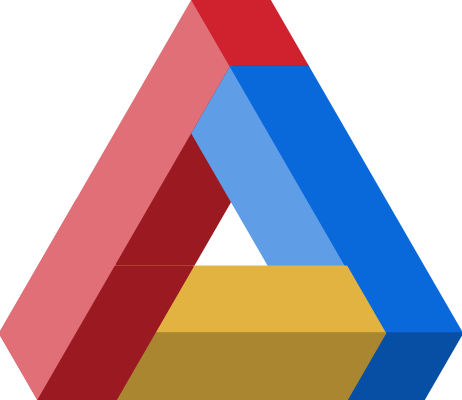
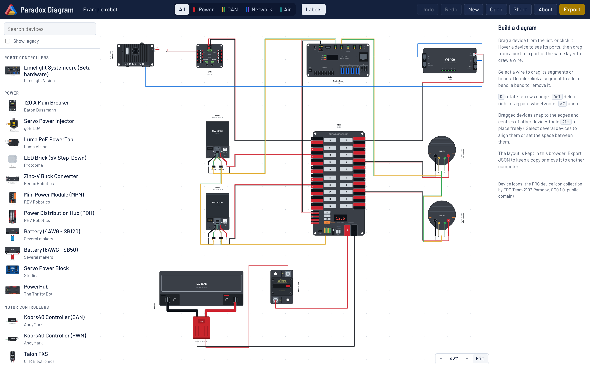
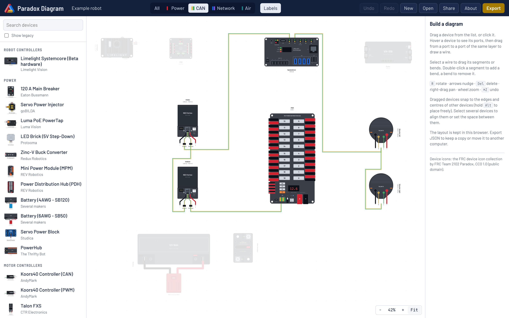
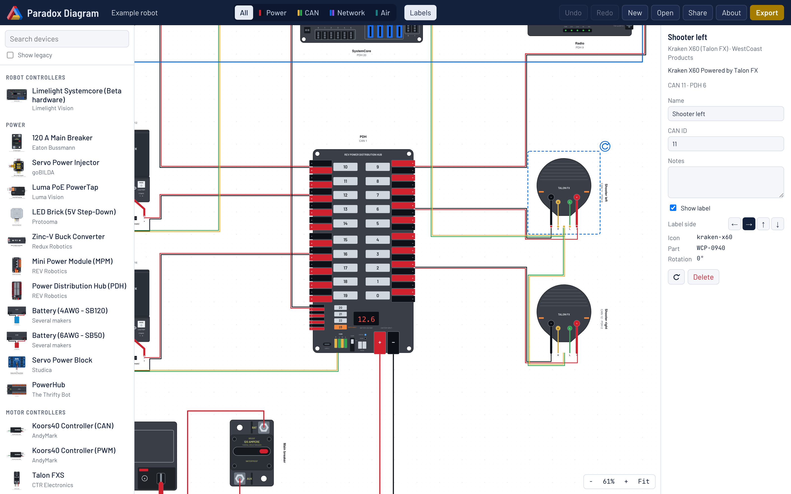
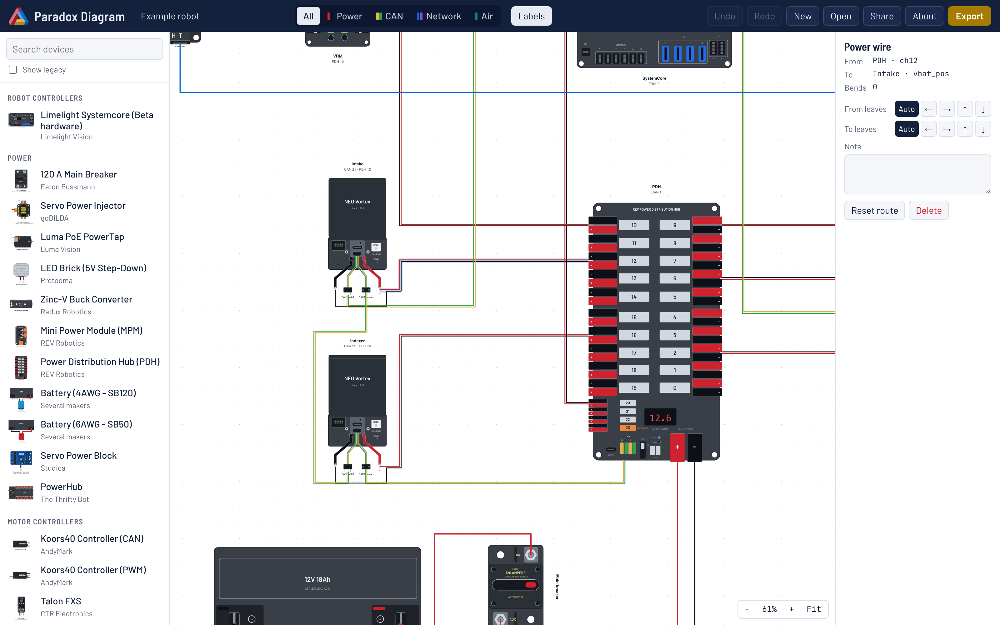
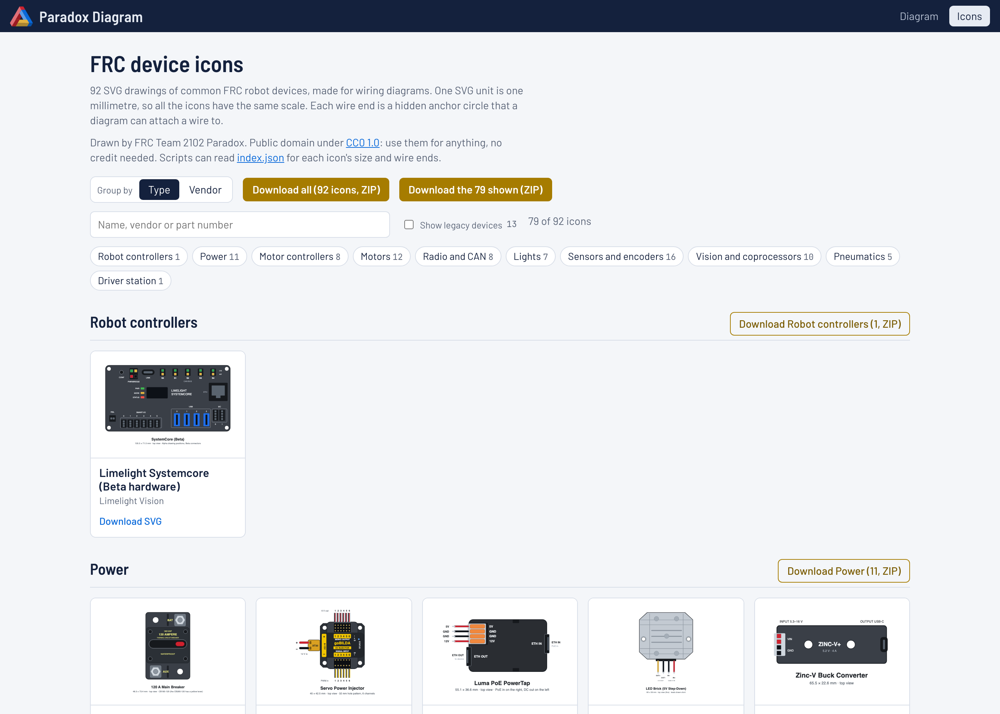
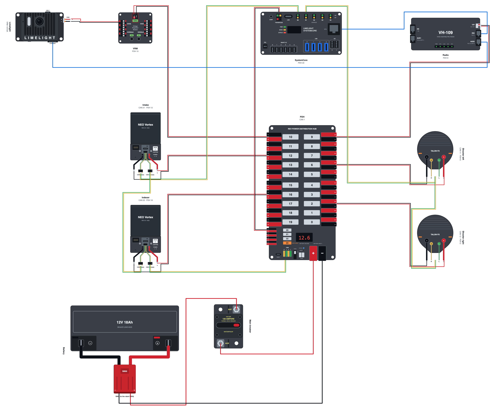

<p align="center">
  
</p>

<h1 align="center">Paradox Diagram</h1>

<p align="center">
  Lay out your FRC robot's wiring in the browser: power, CAN, network and air, drawn with real device icons.<br>
  No account, no install. Your diagram stays in your browser until you export or share it.
</p>

<p align="center"><strong><a href="https://diagram.team2102.org">Open Paradox Diagram → diagram.team2102.org</a></strong></p>



Paradox Diagram is a web app made by [FRC Team 2102 Paradox](https://docs.team2102.org) for any FRC team.
You place devices from the FRC device icon collection, draw wires between their real ports, and export a
diagram that looks like a team wiring poster.

## Features

- **Real device icons.** 93 FRC devices (controllers, PDH / PDP / PowerHub, motor controllers, motors, sensors,
  radios, vision, pneumatics) with every port where it is on the real device. Search by name, vendor or part
  number.
- **Four layers.** Power, CAN, Network (Ethernet, USB, signal) and Air. Show all of them, or one at a time.
- **Wires that route themselves.** Wires go around devices and labels, and leave each port by its own side.
  Drag a segment or add bends where you want a different path, and choose the side a wire leaves a port by.
- **Power drawn like the real thing.** A power cable is a red and black pair. Battery, breaker and
  distribution inputs are single conductors. A cable to a device with separate + and − terminals splits near
  the device.
- **Labels that fill themselves in.** Each device shows its name, its CAN ID and the channel its power comes
  from (`PDH 4`, `PDP 2`, `PH 7`, `MPM 1`, `VRM 12V/2A`). Put a label on any side of its device, or hide it.
- **Tidy layouts.** Devices snap to the grid and to the edges and centres of other devices. Select several
  devices to align them or set the space between them.
- **Export and share.** SVG and PNG (2× or 4×) for posters and slides, JSON to keep a copy, and a share link
  that opens the same diagram for anyone, with no account. SVG and PNG get a title block (title, team, revision,
  date and layer) unless you turn it off in the Export menu.
- **Check for problems.** The **Check** button lists CAN IDs used twice on one bus, CAN devices with no ID, a CAN bus
  whose far end has no 120 Ω terminator, devices with no power, power channels that feed two devices, and devices or
  labels on top of each other. Click a problem to select its devices.
- **CAN terminators.** A CAN bus needs 120 Ω at each end. SystemCore, the roboRIO and a CANivore have one built in,
  so they are one end. End the bus at a **CAN Terminator (120 Ω)** (any 120 Ω resistor, such as AndyMark am-4111),
  a SWYFT CANender, or a PDH or SWYFT Direct with its TERM switch on.
- **Device table.** Export → Table (CSV) gives one row per device with its CAN bus, CAN ID, power channel, fuse,
  wire gauge, IP address and your own fields, for code constants or a sheet inside the robot.
- **Copy and paste.** Copy, paste and duplicate devices with the wires between them. Each copy gets the next free
  CAN ID.
- **Saved as you go.** The layout is kept in your browser, with undo and redo.
- **Dark mode.** Follows your system setting, or pick Light or Dark with the button in the top bar. Exports
  always come out on white.
- **Build it with an AI.** An MCP server lets an AI agent (Claude, Cursor and others) add the devices, connect them,
  lay them out and fill in CAN IDs, power channels, fuse sizes and IP addresses, while you edit the same diagram live.
  See [Use it with an AI](#use-it-with-an-ai).
- **Details on every device and wire.** IP address, CAN bus (found from the CAN chain when you leave it empty; with
  two or more CANivores, their buses are CANivore 1, CANivore 2, ...), your
  own label/value fields, and fuse size and wire gauge on power wires. They show in the label when you want them to.
- **Icon gallery.** Browse every icon at [diagram.team2102.org/gallery](https://diagram.team2102.org/gallery) and
  download one SVG, a whole group (by type or by vendor), the icons a search finds, or the whole collection as a
  ZIP.

## Screenshots

### One layer at a time

Pick a layer in the top bar. Devices with no port on that layer fade, so the CAN bus or the power tree is easy
to follow.



### Device details

Select a device to give it a name and a CAN ID, write notes, move or hide its label, and rotate it. The panel
shows the device's full description and part number.



### Wire details

Select a wire to see its two ends, choose which side each end leaves its port by, or reset its route. Here the
PDH channel 12 cable runs to the SPARK Flex + terminal and the black conductor splits off to its − terminal.



### Icon gallery

The **Icons** page shows every device drawing. Search it, group it by type or by vendor, open a drawing large,
and download one SVG, a group, your search results or all of them as a ZIP.



### What you export

The SVG and PNG exports draw the devices, wires and labels on white, ready to print.



## Use it with an AI

Paradox Diagram has an MCP server, [`@paradox2102/diagram-mcp`](mcp/README.md). Add it to your AI app:

```bash
claude mcp add paradox-diagram -- npx -y @paradox2102/diagram-mcp
```

Then tell the AI about your robot. It makes the diagram file, opens it in your browser with a live link, and builds
the diagram while you watch. You can drag, rename and edit at the same time: your changes reach the AI, and its
changes reach you. Undo in the browser undoes only your own edits. Setup for Claude Desktop and Cursor, the tool
reference and the file format are at [diagram.team2102.org/api](https://diagram.team2102.org/api).

## Build a diagram

1. Find a device in the list on the left. Drag it onto the canvas, or click it to add it at the centre.
2. Hover a device to see its ports. Drag from a port to a port of the same layer to draw a wire.
3. Select a device to name it and give it a CAN ID. Select a wire to change its route.
4. Click **Check** to find problems such as a CAN ID used twice.
5. With nothing selected, fill in **Team** and **Revision** for the title block.
6. Use **Export** to save an SVG, a PNG, a JSON file or the device table, or **Share** to copy a link.

To try it with a full robot, use **New → Example robot**, or the button in the help panel. The file is
[`examples/example-robot.paradox.json`](examples/example-robot.paradox.json).

| Action | How |
|---|---|
| Pan | Right-drag, middle-drag, or Space + drag |
| Zoom | Mouse wheel, or the − / + / Fit buttons |
| Select several | Drag a box on empty space; Shift + click adds to the selection |
| Move | Drag a device (hold Alt to place it without snapping); arrow keys nudge 1 mm, Shift + arrow 5 mm |
| Rotate | R, or the rotate handle on a selected device |
| Delete | Delete or Backspace |
| Copy, paste, duplicate | Ctrl/⌘ + C, Ctrl/⌘ + V, Ctrl/⌘ + D |
| Undo / redo | Ctrl/⌘ + Z, Ctrl/⌘ + Shift + Z |
| Add or remove a bend | Double-click a wire segment, or a bend |

## Files and share links

- **JSON** is the full diagram (`"format": "paradox-diagram"`). Open it again with **Open** on any computer.
- **Share links** hold the whole diagram, compressed, in the part of the URL after `#`. That part is never
  sent to a server. A link always opens the version you shared; share again after you make changes.
- **Your browser** keeps the last layout (local storage). Clear the site data, or use a private window, and it
  is gone, so export a JSON copy of work you want to keep.

## Run it locally

You need [Node.js](https://nodejs.org) 24 or later.

```bash
npm ci
```

```bash
npm run dev
```

The app runs at the address Vite prints (for example `http://localhost:5173`). Other commands:

| Command | What it does |
|---|---|
| `npm run check` | Type check and run all tests (Vitest) |
| `npm run build` | Build the MCP server, the tool reference and the static site |
| `npm run preview` | Serve the built site |

The hosted app is static files only: no server and no database. The MCP server runs on the user's own computer. The `Dockerfile` builds the site (after the checks
pass) and serves it with [Caddy](https://caddyserver.com); this is how the hosted app runs.
`scripts/check-headers.sh <url>` checks a running copy's cache and security headers.

## Releases

A push to `main` runs the checks (GitHub Actions) and does not change the live site. To deploy:

1. Set the new version in `package.json` and `mcp/package.json` (`npm version 1.2.0 --no-git-tag-version`, at the
   root and in `mcp/`), commit and push.
2. Publish a GitHub release with the tag `v1.2.0`.

The **Deploy** workflow checks that the tag matches both versions and runs the checks. Then it moves the `release`
branch to that tag, and Railway, which auto-deploys only the `release` branch, builds and deploys it. After that it
publishes `@paradox2102/diagram-mcp` to npm (trusted publishing, no token). The About box shows the version that is
live.

## Project layout

```
src/
  catalog/    the icon index: devices, ports, search, port polarity
  model/      the diagram document, its actions (undo/redo), checks for opened files, labels
  geometry/   wire routing, lanes, + / − splits, label placement, alignment
  export/     SVG, PNG and JSON export
  share/      share links
  storage/    browser autosave
  live/       the live link to the MCP server (tab side)
  ui/         React components
mcp/          the MCP server (@paradox2102/diagram-mcp): tools, edit operations, layout, render, live server
public/icons/ the FRC device icon collection (copied in, see below)
public/api/   the tool reference (made by the build) and the file format's JSON Schema
examples/     an example diagram
docs/         design notes and screenshots
```

## Device icons

The icons come from the FRC device icon collection by Team 2102, published at
[github.com/Paradox2102/PrettyDocs/tree/main/public/icons](https://github.com/Paradox2102/PrettyDocs/tree/main/public/icons)
and dedicated to the public domain under [CC0 1.0](public/icons/LICENSE.md). A copy is committed in
`public/icons/`, so the app builds on its own. Team 2102 maintainers update the copy with `npm run sync-icons`.

Missing a component, or found a port in the wrong place? Ask me to add or fix it. Include the device name and a
link to the product page or the documentation of each part. You can:

- Email [nickfoote@team2102.org](mailto:nickfoote@team2102.org?subject=Paradox%20Diagram%3A%20component%20request).
- Send a Chief Delphi message to
  [footie](https://www.chiefdelphi.com/new-message?username=footie&title=Paradox%20Diagram%3A%20component%20request).
- Open a [GitHub issue](https://github.com/Paradox2102/ParadoxDiagram/issues/new).

## Privacy and usage counts

The site saves no identifying information. It has no accounts and no cookies, and your diagram never goes to the
server: the browser keeps it, and a share link carries it after the `#`, which browsers do not send.

To know if the app is in use, it counts general usage only:

- A share, an export or an icon download (one SVG or a ZIP) sends one empty request to `/e/share`, `/e/export` or
  `/e/icon`. The request carries nothing about you or your diagram. The local copy that the MCP server runs sends
  nothing.
- Railway, the web host, logs each request with its time, path, IP address and browser name, as web hosts do, and
  deletes the log after a set time.
- `npm run usage` reads that log and prints daily totals only: visitors, page visits, shares, exports and icon
  downloads. It uses the IP addresses in memory to count each visitor once, and never prints or saves them. Only the
  totals are kept.

## Credits

Made by [FRC Team 2102 Paradox](https://docs.team2102.org).

## License

The code is under the [MIT License](LICENSE). The device icons are [CC0 1.0](public/icons/LICENSE.md), and the
Liberation Sans fonts in `mcp/assets/fonts/` are under the [SIL Open Font License 1.1](mcp/assets/fonts/LICENSE).
